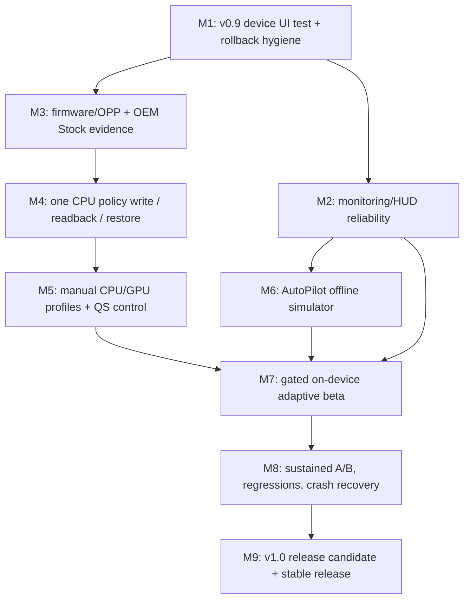

# O2P Control Center — Development map and release gates (v0.9 → v1.0)

**Planning date:** 2026-11-09. **Target hardware:** AYN Odin 2 Portal Base, Snapdragon 8 Gen 2, stock firmware unless explicitly retested.
**Status:** Proposed sequencing, not a statement that untested kernel controls work. No fixed dates; advance only after the evidence gate is met.

## Product outcome

Build a premium **landscape-first controller-friendly app** for: (1) safe, exact-OPP underclock maximums and reusable profiles; (2) low-overhead real telemetry, recording and HUD; (3) adaptive ceiling optimization after repeatable proof of better sustained frame pacing/power; (4) a polished four-theme interface. No overclock, undervolt, governor swapping, thermal disabling, speculative root/su commands, or duplicative AYN fan, charge separation, trigger/controller functions. Display color is a **native Android settings shortcut** unless a fully reversible Portal-specific mechanism is validated; no fake saturation slider.

## Existing, unmerged branch chain

- `main`: untouched by v0.9 UI work.
- [PR #20 — v0.8 Alpha 2](https://github.com/locutus5382/O2P-Control-Center/pull/20) from `feature/v08-alpha2-readonly-discovery`: read-only discovery, PServer typed `errno`, telemetry, export; **draft, device validation outstanding**.
- [PR #21 — v0.9 UI specification](https://github.com/locutus5382/O2P-Control-Center/pull/21) from `design/v09-premium-four-pillar-ui-spec`: four-pillar UI proposal; **draft**.
- [PR #22 — v0.9 Alpha 1 UI code](https://github.com/locutus5382/O2P-Control-Center/pull/22) from `feature/v09-four-pillar-navigation`: four destinations, four theme families and 18 accents, Easy/Pro, diagnostic gate and native display shortcut; **draft, Gradle tests/APK build pass, physical UI test pending**.
- Do **not** assume that because PR #22 compiles it is merged, tested on the Portal or safe for privileged writes. Review and integrate parent PRs in dependency order or prepare a separately tested integration branch.

## Branching, on-device rollback and distribution contract

1. Keep `main` release-stable. Feature work stays on named branches with draft PRs. Do not merge until CI **and** physical Portal gates pass.
2. At every physical-device-accepted milestone, record an immutable release tag, source SHA, signed APK checksum, firmware fingerprint and validation notes. Preserve the corresponding known-good APK outside ephemeral GitHub Actions artifacts.
3. Separate source rollback from app installation rollback. Android may reject downgrade by versionCode or APK replacement due to differing signatures. Uninstalling can erase private app data, profiles and recordings. Require explicit support-bundle/preferences export before switching builds.
4. Add a `dev` application ID suffix for future experimental builds to coexist with the production package; verify manifest/service/tile behavior in that variant. Establish consistent protected signing for tester releases, without committing private signing material.
5. For a regression, freeze new work, identify the last passing release and smallest faulty commit, revert on the feature/integration branch, re-run tests, then manually verify. Do not silently overwrite OEM state.
6. Use a clean, reviewed integration/release branch once the stacked PR chain is approved. Never merge a descendant PR alone without understanding which ancestors it includes.

## Dependency map

M2 and M3 may proceed in parallel; M6 simulation may start before M5 completion but **must not** write to hardware. Manual M4 must follow the safety proof in M3. Avoid prolonged diagnostics-only iteration once M3's decision questions are answered.

## Nine milestones with evidence-based exits

| Milestone | Working increment | Acceptance / stop gate | Release target |
|---|---|---|---|
| **M1 — UI + rollback** | Install v0.9 alpha; verify Underclock/Telemetry/Advanced/Diagnostics, 4 families × 18 colorways, A/B and L1/R1 navigation, read-only Easy/Pro, existing QS deep links, stock HUD unchanged; fix bugs; establish archived APK and safe dev signing strategy. | No crashes, no missing or misleading state, no controller focus traps, all tabs legible on 7-inch landscape; old build remains restorable without surprise data loss. | v0.9 Alpha 2 |
| **M2 — monitoring and HUD** | Reuse one sampler; repair Eden HUD visibility after game launch, overlay reattach and process-loss behavior; chosen fields, recording pause/stop, history, performance overhead. FPS labeled unavailable unless actual layer timing is proven. | HUD visible **over running Eden** when permitted, not just before launch; stopped/failed sessions not shown as live; no duplicated polling; measured overhead and memory pressure acceptable. | v0.9 Alpha 3 |
| **M3 — device capability and Stock evidence** | One consented read-only Portal capture: PServer host identity, per-node `errno`, actual CPU policies and OPP tables, KGSL GPU nodes/units, current effective maxima/minima, OEM mode and thermal sensors. Define Stock baseline provenance. | Every candidate writer node identified, allowable exact OPPs and readback known; original values, OEM ownership, error cases and firmware fingerprint documented. **If not proven, M4 blocks.** | v0.9 readiness gate |
| **M4 — transactional CPU proof** | Single allowlisted CPU max-frequency ceiling with user confirmation, serialized operation, baseline snapshot, bounded one-OPP change, exact independent readback, Stop/Restore. Simulate partial failure, external writer, timeouts, crash. | CPU cannot exceed baseline/allowed step, `min <= max`, restore only last app-owned values; denial and external override visible; no claim of guaranteed crash recovery without validated watchdog. | v0.9 manual experimental |
| **M5 — useful manual tuning** | Extend validated mechanism to CPU policy domains and GPU **only if** writable OPP and safe rollback physically verified. Stock/Light/Moderate/Strong/custom profiles, per-emulator profile selection when detection reliable, single authoritative Quick Settings Apply/Restore flow. | All enabled profiles read back correctly, persist only as user preferences (not boot writes), and recover under app exit/interruptions; conflicts with ClusterTune/OdinTools warned, never killed. | v0.9 Beta (manual MVP) |
| **M6 — AutoPilot offline safety** | Pure Kotlin synthetic/recorded telemetry simulator; headroom/frame pacing signal confidence, state machine, hysteresis, cooldowns, one-step probes, menu/loading freeze. Compare vs fixed profiles. | Invariant tests: never over baseline, never tune without valid FPS/thermal evidence, no oscillatory writer, no command if insufficient confidence. **No hardware adaptive writes.** | v0.10 simulation |
| **M7 — adaptive beta on Portal** | Opt-in user-started sessions; use exactly the M5 gateway, ownership and rollback; AYN thermal veto, external writer suppression, verified game timing, bounded adaptive steps, explicit Off/Manual/AutoPilot state. | In real play the app restores at session end, responds safely to permission/telemetry loss and high thermal state, and cannot race OEM/another tuner. If not proven, adaptive mode disabled. | v0.10 Beta |
| **M8 — performance and failure validation** | Repeatable A/B stock vs manual vs adaptive in Eden plus one additional demanding workload; FPS P95/P99 frametime proxy confidence, thermal trend, power proxy if supported, battery effect, memory, overnight/long play; force-stop/service crash/reboot matrix. | Improvement (or neutral result) demonstrated by real comparable trials; no safety/restore regressions; documented unsupported metrics, costs and known limitations. Negative results force design change rather than marketing claims. | v1.0 Release Candidate |
| **M9 — stable release** | Accessibility, 7-inch landscape layouts, reduced motion, focus contrast, no hidden activities, truthful screenshots, privacy and troubleshooting, localized labels if needed, changelog, licenses, release signing, firmware compatibility, tested release artifacts. | CI green, device acceptance checklist complete, signed APK preserved, rollback instructions tested, clear feature availability, no claims beyond evidence. | v1.0.0 |

### Immediate test report: M1

Please report **pass/fail** plus one screenshot or short description only for failures in:
- Navigation: all four tabs, D-pad/A/B, L1/R1, no focus traps.
- Themes: Obsidian/Aero/Violet/Decky and several extreme accent choices; readable contrast, appropriate viewport and text sizes.
- Underclock: Easy/Pro, exact steps when available, Apply/Restore visibly locked.
- Telemetry: start recording, launch Eden, confirm HUD **stays above the game**, stop via tile/notification, inspect session history.
- Advanced/Diagnostics: display shortcut, Quick Settings tile links, diagnostics OFF does not enable writes or hide normal telemetry.

Capture crash logs only if there is a crash. Do not ask for repeated large JSON dumps unless they solve a specific M3 blocking question.

## Definition of done for every feature PR

- Linked issue/goal; explicit scope and avoided unsafe actions.
- Tests: unit or fake hardware tests, CI Android debug APK build, and hardware checklist for firmware-dependent features.
- UI clearly differentiates **selected preview**, **requested action**, **confirmed effective value**, **unknown**, and **restore incomplete**.
- No fabricated temperature, FPS, RPM, power estimate, or Stock baseline.
- Regression tests and rollback note. No unnecessary network or tracking permissions.

## Decisions deliberately deferred

- **Display saturation/color temperature:** native settings first; no speculative SurfaceFlinger transaction 1022, color wheel or fake readback. Only revisit after independent reversible proof on Portal firmware.
- **Fan, bypass charging, trigger/controller/vibration duplication:** do not build.
- **Boot auto-tuning:** off and out of scope for v1 without an independently validated recovery design.
- **AutoPilot without reliable game frame signal:** stays disabled; manual controls and monitoring remain useful.
